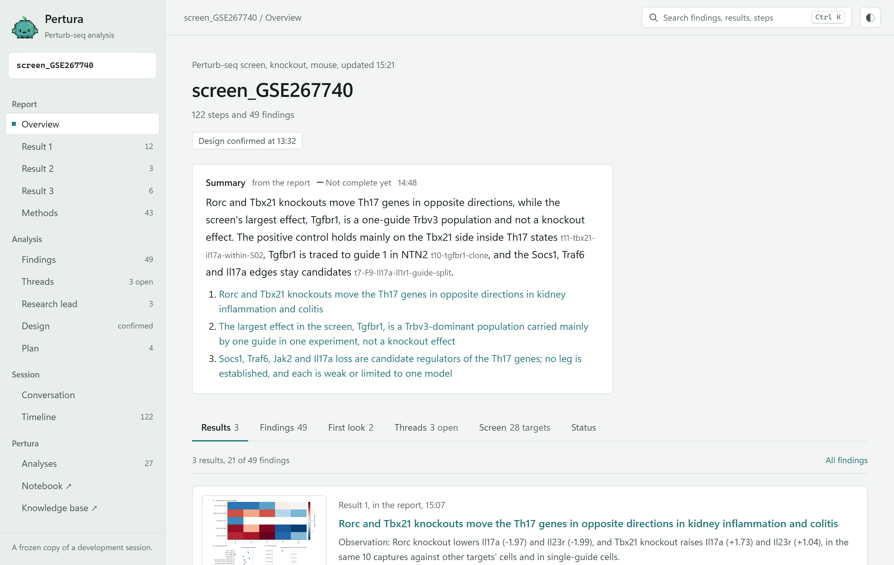
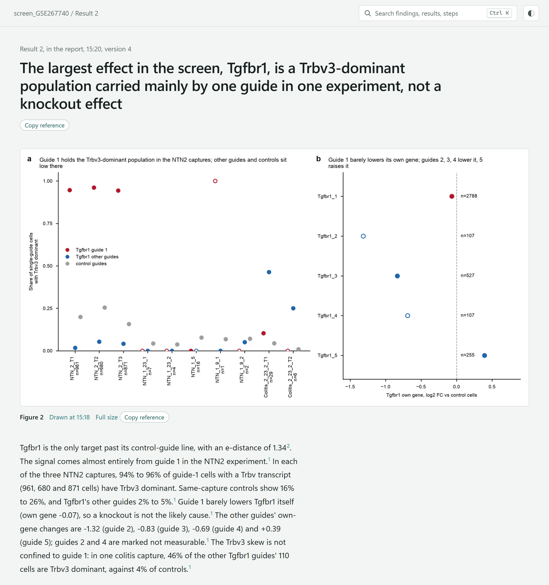
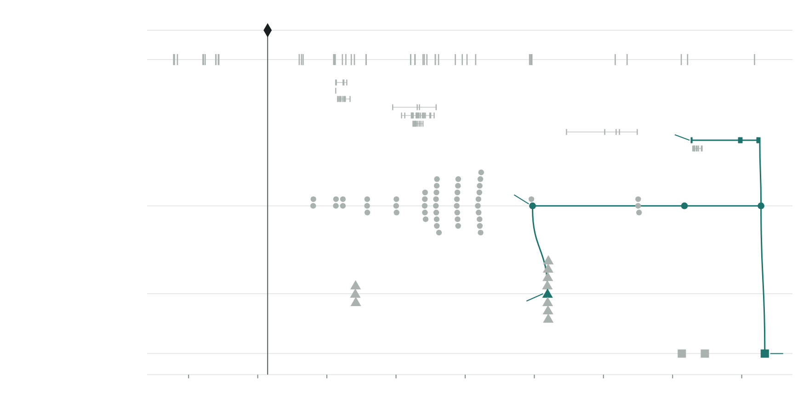

<p align="center">
  
</p>

<h1 align="center">Pertura</h1>

<p align="center"><b>Perturb-seq analysis in Claude Code</b></p>

An agent can analyse a Perturb-seq screen quickly. It can also compare the wrong groups of cells, attribute a signal
from one guide to the gene, or report numbers that no run produced.

Pertura is a Claude Code plugin for traceable and reliable Perturb-seq screen analysis. First, Pertura confirms the
experimental design with the user on control cells, replicates, perturbation types and conditions, which will affect
the downstream analysis. Then the agent analyses the screen on the user's server, and Pertura records the code and
output of every run. For findings about a gene, a gene set, a score or a cell state, Pertura repeats the test in each
guide and against groups of control guides. A separate review agent reads each result with its runs and writes
comments. Finally, every finding in the report links to its runs, checks and review comments, so the user can trace
each number back to its code.

The [website](https://cyclization-w.github.io/Pertura/) shows two example reports.

<picture>
  <source media="(prefers-color-scheme: dark)" srcset="assets/page_overview_dark.png">
  
</picture>

<p align="center"><sub>The page that Pertura writes on the user's computer during a session, here for a development
session on the public screen GSE267740.</sub></p>

## Pertura's capabilities

- **Design confirmation.** A design auditor agent reads the deposited files and metadata and measures the design facts
  in the data. Pertura then shows the proposed design to the user on a form: the control cells, the replicates, the
  perturbation type and the conditions. The analysis tools run only after the user confirms the design.
- **Checks on each finding.** The agent states each finding with its targets, its feature, its direction and its runs.
  The feature can be a gene, a gene set, a score or a cell state. Pertura then repeats the test in each guide, with
  other standard tests, on groups of control guides and in each half of the replicates. If a check cannot run, Pertura
  records the reason.
- **Automated review.** After each turn, a separate review agent reads the new results with their runs and checks, and
  it records its doubts. The main agent then tests each doubt and records its answer.
- **Subagents for other choices.** Some choices can change an answer, such as a threshold or a definition. For each of
  these choices, a subagent repeats the analysis with the common alternative, and the agent compares the two results.
- **A traceable report.** Pertura keeps every run, finding, check, doubt and reply in one record. The report is built
  from this record. Each result has its figure, its statement with references to its runs, and its limits. The user
  decides which results go into the report.

## A case study from a previous session

Here is a case study from a development session on 14 November 2026. In that session, Pertura analysed the public
screen GSE267740, a knockout screen of 28 targets in mouse Th17 cells. The largest effect in the screen was a knockout
of Tgfbr1. The agent's first reading of this effect changed twice before it went into the report.

1. **14:29, first reading.** The agent records the Tgfbr1 signal as a clonal expansion in guide 1, not a knockout
   effect.
2. **14:32, review comment.** The review agent writes that a dominant Trbv gene does not prove a clone, because many
   clones share a Trbv gene and the data have no CDR3 sequences. One minute later, the agent narrows the claim to a
   Trbv3-dominant expansion carried by one guide in one experiment. At 15:02, it rewrites the finding after a check in
   each of the three NTN2 captures.
3. **15:04, a subagent checks each capture.** It recomputes the share of Trbv3-dominant cells for guide 1, the other
   Tgfbr1 guides and the controls in each capture, and it draws the figure. At 15:19, its results change the wording
   again: the Tgfbr1 expression values for guides 2 to 5 differ from the earlier text, and one colitis capture shows
   Trbv3 enrichment in the other Tgfbr1 guides.
4. **15:20, the report.** Result 2 describes a Trbv3-dominant population carried mainly by one guide in one
   experiment. In each of the three NTN2 captures, 94% to 96% of guide-1 cells with a Trbv transcript are
   Trbv3-dominant, against 16% to 26% of control cells from the same capture. Guide 1 barely lowers Tgfbr1 itself.
   Because the signal sits in one guide, it says little about a gene-level knockout effect.

<picture>
  <source media="(prefers-color-scheme: dark)" srcset="assets/page_result_dark.png">
  
</picture>

The figure below shows the whole session from its record. Each mark is an event. The numbers 1 to 4 are the steps
above.

<picture>
  <source media="(prefers-color-scheme: dark)" srcset="assets/session_timeline_dark.png">
  
</picture>

<sub>The reports on the website come from development sessions on public datasets. They include automated review
comments. No human expert has reviewed their findings.</sub>

## The Pertura system

- **A persistent workspace for Claude Code.** The MCP server runs on the analysis server, and the plugin connects to it
  over SSH. It keeps a Python notebook open on the screen data, so variables and loaded data stay in memory between
  calls. The agent reaches the eleven analysis tools, R and other programs from this notebook.
- **A record of the analysis.** The record is an event log on the analysis server. It keeps the design, every run with
  its code and output, every finding with its checks and earlier versions, every doubt with its answer, and the user's
  replies. A recorder writes the record from the conversation after each turn, so the agent does not spend its time on
  bookkeeping.
- **Knowledge from published screens.** A knowledge base gives the agent cards on analysis choices, common pitfalls and
  follow-up analyses, with examples from published papers. The agent can also look up published Perturb-seq screens,
  protein complexes and gene sets, and search PubMed and bioRxiv. A second plugin reads published papers into the
  knowledge base.
- **A page on the user's computer.** After each Pertura tool call, the plugin saves the figures and writes a page on the
  user's computer. The page shows the results with their figures, the findings with their checks and doubts, the
  design, the methods and every step of the session. It needs nothing installed.

## Installation

The Claude Code plugin connects over SSH to an MCP server on the Linux machine that holds the screen data.

1. **Environments.** On the analysis server, create the two Conda environments from the files in `envs/specs/`:
   - `pertpy`: Python with scanpy, pertpy, decoupler and pydeseq2;
   - `r45-singlecell`: R 4.5 with Seurat, edgeR, limma, DESeq2, glmGamPoi, MAST, sceptre and other packages.

   Set `PERTURA_BASE` to the folder that contains the environments. The default is `~/pertura`. You can also set each
   path with its own variable: `PERTURA_R_HOME`, `PERTURA_PY_ENV`, `PERTURA_GENE_SETS`, `PERTURA_PRIOR_SCREENS` and
   `PERTURA_CORUM`.
2. **Reference data.** This repository does not contain the gene-set databases (MSigDB, CollecTRI, PROGENy) or the
   prior-screen references. Put them in `$PERTURA_BASE/resources/`. The files `src/pertura/gene_sets.py` and
   `src/pertura/prior_screens.py` show the layout of the folder.
3. **Workspace.** Generate the workspace configuration on the analysis server:

   ```bash
   python -m pertura.mcp_server make-workspace-config <workspace folder> --cores 60-71 --thread-limit 12 > workspace.json
   ```
4. **Plugin.** In Claude Code, install the plugin from `plugin/`. In the plugin settings, enter the analysis host, the
   Python of the server, the path of this repository on the server and the workspace configuration. To start a
   session, type `/pertura`.

To run the tests, type `PYTHONPATH=src python -m pytest tests`. The tests that need R or the server environments do not
run without them.

## Files in this repository

| Path | Contents |
|---|---|
| `src/pertura/` | The MCP server and the analysis code. The plugin starts the server with `python -m pertura.mcp_server serve-analysis <workspace config>`. |
| `src/pertura/r/` | The R scripts that call the R packages. |
| `plugin/` | The Claude Code plugin: the skill, the agents, the hooks and the page. |
| `plugin_paper_reading/` | A second plugin. It reads published papers into the knowledge base. |
| `tests/` | The tests. |
| `envs/specs/` | The Conda environments of the analysis server. |
| `assets/` | The images in this file. |

## Known limits

- This repository is a frozen copy of the development version of November 2026.
- The installation is large. It needs an analysis server with the environments above.
- Some data deposits have an unusual structure, for example two guide libraries in one experiment. For these deposits,
  it can take a long time to make the screen object.
- If a screen has few cells for each guide, or no independent replicates, most checks cannot run.
- Some docstrings refer to design records (`docs/adr/...`) and to research code. These files are not in this
  repository.
- The plugin uses three commands of `pertura.mcp_server`: `make-workspace-config` (you run it once), `serve-analysis`
  (the MCP server) and `apply-inbox` (the recorder runs it). Some other commands in `mcp_server.py` are from earlier
  designs.

## Citation

An early version of Pertura was presented at the ICML 2026 GenBio Workshop.

## License

MIT. See `LICENSE`.
